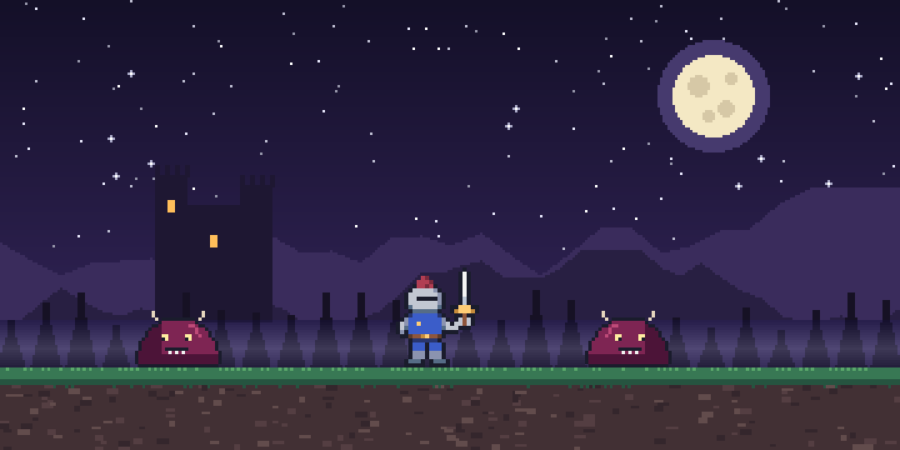

# Blade Rush

A small 2D action game made in Unity 6. You play a knight defending a hill at night against waves of slimes. Every wave brings more enemies, and they get faster and tougher as you go. How long can you last?



<!-- Gameplay GIF: record a short clip, save it as docs/gameplay.gif and uncomment the next line -->
<!--  -->

## Controls

| Action | Keys |
|--------|------|
| Move | A / D or ← / → |
| Jump | Space, W or ↑ (hold for a higher jump) |
| Attack | J or left mouse button |
| Next wave | Enter (or the Continue button) |
| Retry after game over | R / Enter (or the Retry button) |

## Features

- **Wave system:** wave *N* spawns *N* × 3 slimes from both sides of the screen, one after another. Enemies gain +1 health every two waves and move a bit faster each wave.
- **Combat:** sword attack with a cooldown, a slash effect, knockback and a short stun on hit. Enemies flash red when damaged and squash flat when they die.
- **Player feel:** coyote time (you can still jump right after leaving a ledge), jump buffering (a jump pressed just before landing still happens) and variable jump height.
- **Damage and health:** contact damage with knockback, a short invincibility window after each hit (the player blinks), and a health bar that slides down and shifts from green to red. Clearing a wave heals 1 health.
- **Game flow:** "Wave N cleared!" screen between waves, a game over screen showing the wave you reached, and a death counter plus best wave that carry over between retries.
- **Audio:** looping chiptune music and sound effects for jumping, attacking, hits, enemy deaths, clearing a wave and game over.
- **Original art and sound:** all sprites, music and sound effects were made for this project.

## Running the project

1. Install **Unity 6** (made with 6000.0.47f1; any Unity 6.0 version should work) through Unity Hub.
2. In Unity Hub, choose **Add → Add project from disk** and select this folder.
3. Open `Assets/Scenes/MainScene` and press **Play**.

The first time you open it, Unity rebuilds its `Library` folder, which takes a minute or two.

### Making a playable web version

1. **File → Build Profiles** (or Build Settings), select **Web**, and switch to it.
2. Check that `MainScene` is in the scene list, then click **Build**.
3. Zip the build folder and upload it to [itch.io](https://itch.io) as an HTML game, so anyone can play it in the browser.

## How it's built

```
Assets/
├── Scripts/
│   ├── PlayerMovement.cs   movement, jumping, ground detection, knockback
│   ├── PlayerAttack.cs     sword attack, hit detection, slash effect
│   ├── Health.cs           health, invincibility, hit flash, death (player and enemies)
│   ├── EnemyFollow.cs      enemies walk towards the player
│   ├── EnemyDamage.cs      contact damage and knockback
│   ├── EnemyManager.cs     waves, spawning, difficulty, wave cleared screen
│   ├── GameManager.cs      game over, retry, death counter, best wave
│   ├── HealthBarUI.cs      health bar
│   └── Sfx.cs              plays sound effects from Resources/Audio
├── Prefabs/EnemyPrefab
├── Scenes/MainScene
├── Sprites/                player, enemy, background, ground, UI
├── Audio/                  music
└── Resources/Audio/        sound effects
```

A few details:

- **Ground detection** looks at the collision contact normals instead of a "Ground" tag, so the player can stand on any surface but can't jump off walls or off enemies' heads.
- **The same `Health` script** is used by the player and the enemies. It fires the right game event when something dies: game over for the player, wave progress for an enemy.
- **Contact damage** is checked every physics step while touching, but the player's invincibility window spaces the hits out, so touching an enemy costs one health at a time instead of draining the whole bar.
- **Enemies ignore collisions with each other** (layer collision matrix set from code), so a wave moves like a horde instead of stacking into a tower.

## Changes in the latest version

- Replaced the placeholder art and music with original sprites, a chiptune soundtrack and sound effects.
- Fixed enemies not spawning: the enemy prefab wasn't connected to the EnemyManager after a field rename.
- Fixed the player dying and being counted multiple times, being able to move after game over, and tipping over when hit.
- Fixed the health bar: it was partly off screen and never went down.
- Fixed the death counter, which never updated.
- Fixed the build only including an empty sample scene.
- Enemies now walk along the ground with physics instead of floating through it, and spawn from both sides of the screen.
- Added the attack cooldown, knockback, hit effects, invincibility frames, jump improvements, difficulty scaling, best-wave tracking and keyboard shortcuts for the menus.

## Author

Besnik Emini · [GitHub](https://github.com/besnikemini5) · [LinkedIn](https://www.linkedin.com/in/besnikemini1)
